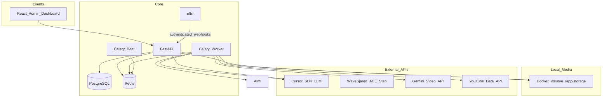
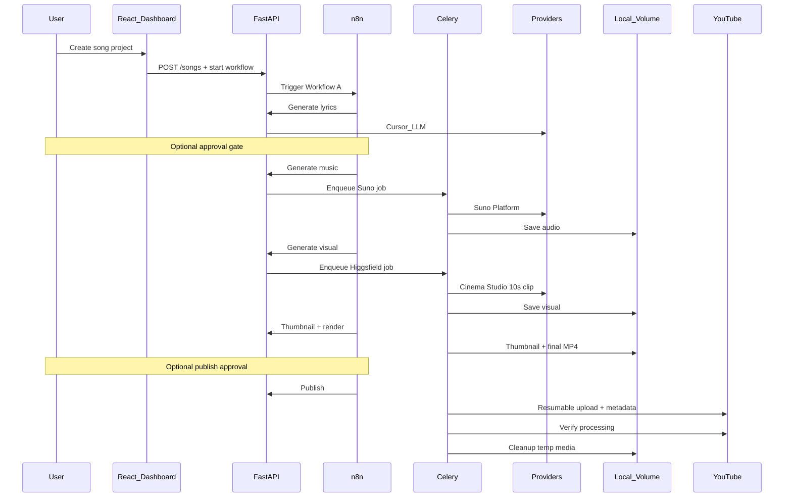

# Architecture

Autonomous Telugu devotional YouTube production platform — modular monolith for local Docker deployment.

Source of product requirements: [`project-plan-promt.md`](../project-plan-promt.md).

## 1. Goals

- Produce complete YouTube-ready devotional music videos with minimal human intervention.
- Orchestrate lyrics → music → visual → thumbnail → FFmpeg render → YouTube publish → local cleanup.
- Keep media on local Docker volumes only (no cloud object storage).
- Stay cost-conscious: one ~10-second visual per song, looped to audio length; budget gates before paid generation.
- Remain extensible for a future multi-scene Ramayana cinematic workflow without implementing it in v1.

## 2. High-level architecture



### Docker Compose services (Phase 1+)

| Service | Role |
| --- | --- |
| `frontend` | React + Vite admin dashboard |
| `backend` | FastAPI application |
| `worker` | Celery worker (FFmpeg, provider polling, uploads, cleanup) |
| `scheduler` | Celery Beat (periodic recovery / schedule checks if needed) |
| `postgres` | Primary metadata store |
| `redis` | Celery broker + short-lived cache |
| `n8n` | Production workflow orchestration |

Named volumes: PostgreSQL data, n8n data, shared media (`/app/storage`).

No Kubernetes and no microservices split in v1.

## 3. Responsibility split

### FastAPI

- Core business logic and REST APIs under `/api/v1`.
- Authentication and authorization.
- Database access (SQLAlchemy 2.x + Alembic).
- Provider adapter interfaces and configuration validation.
- Workflow initiation records and stage command endpoints used by n8n.
- Media path metadata and controlled file access APIs.
- Budget pre-flight checks before enqueueing paid jobs.

### Celery

- Long-running and asynchronous operations only:
  - Music generation status tracking and audio retrieval.
  - Video generation status tracking and clip retrieval.
  - FFmpeg rendering and progress reporting.
  - YouTube resumable upload, metadata, thumbnail, playlist, schedule.
  - Publication verification.
  - Idempotent local media cleanup.
- Must not own product workflow sequencing (that is n8n’s job).

### n8n

- Orchestrate the production lifecycle (stage order, waits, branches).
- Trigger FastAPI endpoints with authenticated webhooks / HTTP nodes.
- Manage approval waits and scheduled publishing triggers.
- Route failures and support resume-from-failed-stage.
- **Must not** duplicate business rules, prompt construction, FFmpeg logic, or provider SDK calls.

### Redis

- Celery broker and result backend coordination.
- Short-lived cache (e.g. job progress snapshots) when useful.
- Not a system of record.

### PostgreSQL

- System of record for projects, versions, jobs, costs, OAuth tokens (encrypted), workflow executions, audit logs.
- Never stores media binary blobs.

## 4. Application layers (backend)

Suggested package layout (implemented from Phase 1 onward):

```text
backend/
  app/
    api/                 # FastAPI routers
    core/                # config, security, logging
    models/              # SQLAlchemy models
    schemas/             # Pydantic request/response
    services/            # domain services
    providers/           # LLM / music / video / image / YouTube adapters
    workers/             # Celery tasks
    media/               # MediaStorageService, FFmpeg helpers
```

Frontend is a separate Vite app that talks only to FastAPI (never to provider API keys).

## 5. Production pipeline



### Critical visual rule

For regular devotional songs:

1. Generate **exactly one** meaningful ~10-second clip (Higgsfield Cinema Studio 4.0 by default).
2. Loop that clip in FFmpeg to match approved audio duration.
3. Do not generate scene-by-scene or lyric-synced visuals in v1.
4. Do not embed text or channel logos in the generated clip; add branding during FFmpeg/thumbnail composition.

## 6. Local media storage

```text
/app/storage/
  temp/
    {song_id}/
      lyrics.txt
      audio.mp3
      visual.mp4
      thumbnail.jpg
      final-video.mp4
  logs/
  cache/
```

`MediaStorageService` responsibilities:

- Create per-project directories.
- Save/validate MIME type, extension, and size.
- Generate safe filenames.
- Provide controlled downloads to authenticated clients.
- Idempotent cleanup after verified publication.
- Recover abandoned job directories per retention policy.

### Cleanup safety

Cleanup runs **only** after:

1. YouTube upload completed.
2. Video ID stored in PostgreSQL.
3. YouTube processing status verified.
4. Metadata and thumbnail updates verified.
5. Publication status recorded.

Failed stages **preserve** files for retry. Cleanup is idempotent and never runs solely because an upload request was accepted.

## 7. Provider abstraction

All external AI/media services sit behind adapters:

| Interface | Implementations (v1) |
| --- | --- |
| `LLMProvider` | `CursorLLMProvider` (`composer-2.5`) |
| `MusicProvider` | `WaveSpeedAceStepProvider` (ACE-Step 1.5), `ManualAudioUploadProvider` |
| `VideoProvider` | `GeminiVideoProvider` (`gemini-omni-1.1-flash` @ **720p**/10s; Shorts cut from same clip), `ManualVideoUploadProvider` |
| `ImageProvider` | `CursorImageProvider` (`composer-2.5` + GenerateImage), `ManualImageUploadProvider` fallback |
| `YouTubeProvider` | `YouTubeDataAPIProvider` |

Music is **WaveSpeed ACE-Step 1.5** (multilingual / Telugu-friendly). Cursor covers **LLM + thumbnails**. Gemini covers **video**. Official Suno Platform remains invite-only.

Rules:

- Business services call interfaces, never raw HTTP clients scattered through routers.
- Never invent undocumented endpoints or parameters.
- Mock providers exist for tests.
- See [`PROVIDER_INTEGRATIONS.md`](PROVIDER_INTEGRATIONS.md) for feasibility and account gates.

## 8. Reliability principles

- Every expensive stage is asynchronous and returns a job ID.
- Stages are independently resumable; successful assets are reused on retry.
- Idempotency keys for paid generation and YouTube upload where supported.
- Before retrying paid generation, reconcile external provider status to avoid duplicate charges.
- Distinguish retryable vs non-retryable failures.
- Structured logs + workflow execution history + provider request logs + audit logs.
- On restart: reconcile incomplete workflows and unknown external jobs (Workflow D).

## 9. Frontend modules

Studio-style React admin (dark/light themes):

1. Dashboard  
2. Song Studio  
3. Lyrics Studio  
4. Music Studio  
5. Visual Studio  
6. Thumbnail Studio  
7. Video Renderer  
8. Publishing Calendar  
9. YouTube Channel  
10. Playlists  
11. Analytics (Phase 9)  
12. Automation  
13. Generation History  
14. Cost Monitoring  
15. Settings  

The frontend never performs background processing or holds provider secrets.

## 10. Cost control

- Track estimated/actual costs per provider call when available.
- Configurable max music candidates, visual attempts, thumbnail attempts, per-song budget, monthly budget.
- Pre-flight budget check before enqueueing paid jobs.
- Never claim precise cost when the provider does not expose it.

## 11. Out of scope for v1 architecture

- Cloud object storage.
- Kubernetes / service mesh.
- Multi-scene cinematic Ramayana pipeline (extension hook only).
- YouTube Analytics optimization loop (Phase 9).
- Unofficial Suno scraping or cookie-based clients.

## 12. Related documents

- [`IMPLEMENTATION_PLAN.md`](IMPLEMENTATION_PLAN.md)
- [`DATABASE_DESIGN.md`](DATABASE_DESIGN.md)
- [`API_SPECIFICATION.md`](API_SPECIFICATION.md)
- [`PROVIDER_INTEGRATIONS.md`](PROVIDER_INTEGRATIONS.md)
- [`N8N_WORKFLOWS.md`](N8N_WORKFLOWS.md)
- [`SECURITY.md`](SECURITY.md)
