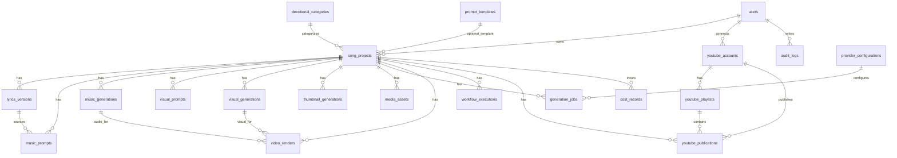

# Database Design

PostgreSQL with SQLAlchemy 2.x and Alembic.

**Rules:**

- UUID primary keys on all entities.
- `created_at` / `updated_at` timestamps (timezone-aware UTC).
- Status enums where lifecycle applies.
- JSONB for flexible provider metadata and configuration.
- **No media binary data in PostgreSQL** — only paths and metadata.
- **No plaintext secrets** — encrypt OAuth refresh tokens and similar at rest.
- Indexes on foreign keys, status columns, and common filters (deity/category, scheduled publish time).

---

## ER overview

---

## Conventions

| Convention | Detail |
| --- | --- |
| PK | `id UUID PRIMARY KEY DEFAULT gen_random_uuid()` |
| Soft delete | Prefer status flags over hard deletes for projects; hard delete only with cascading policy review |
| Money | Store amounts as `NUMERIC(12,6)` + `currency` (`USD` default); mark `is_estimate` boolean |
| Paths | Relative paths under `/app/storage/...`; never expose raw host paths to clients |
| JSONB | Provider request/response summaries (redact secrets), flexible settings |

Suggested shared status patterns:

- Project: `draft`, `in_progress`, `awaiting_approval`, `ready_to_publish`, `publishing`, `published`, `failed`, `archived`
- Job: `queued`, `running`, `waiting_external`, `succeeded`, `failed`, `cancelled`, `needs_review`
- Approval: `pending`, `approved`, `rejected`

---

## Tables

### 1. `users`

| Column | Type | Notes |
| --- | --- | --- |
| id | UUID PK | |
| email | CITEXT UNIQUE NOT NULL | |
| password_hash | TEXT NOT NULL | |
| display_name | TEXT | |
| role | TEXT NOT NULL | e.g. `admin`, `operator` |
| is_active | BOOLEAN NOT NULL DEFAULT TRUE | |
| created_at, updated_at | TIMESTAMPTZ | |

Indexes: unique `email`.

### 2. `devotional_categories`

| Column | Type | Notes |
| --- | --- | --- |
| id | UUID PK | |
| slug | TEXT UNIQUE NOT NULL | e.g. `vishnu` |
| name | TEXT NOT NULL | |
| description | TEXT | |
| is_active | BOOLEAN NOT NULL DEFAULT TRUE | |
| sort_order | INT NOT NULL DEFAULT 0 | |
| created_at, updated_at | TIMESTAMPTZ | |

Seed: Vishnu, Shiva, Lakshmi, Durga, Saraswati, Hanuman, Narasimha, Venkateswara, Rama, Krishna, Ganesha, Subrahmanya, Other.

### 3. `song_projects`

| Column | Type | Notes |
| --- | --- | --- |
| id | UUID PK | |
| user_id | UUID FK → users | |
| category_id | UUID FK → devotional_categories | nullable |
| title | TEXT | |
| topic | TEXT | |
| deity | TEXT | |
| language | TEXT NOT NULL DEFAULT `te` | |
| lyrics_style | TEXT | |
| lyrical_structure | TEXT | chandassu / structure notes |
| charanam_count | INT | |
| include_slokam | BOOLEAN DEFAULT FALSE | |
| music_genre | TEXT | |
| vocal_preference | TEXT | |
| instruments | JSONB | |
| target_duration_seconds | INT | |
| visual_style | TEXT | |
| status | TEXT NOT NULL | |
| approval_mode | TEXT | `manual` / `auto` gates config snapshot |
| template_id | UUID FK → prompt_templates | nullable |
| youtube_settings | JSONB | visibility, playlist prefs, schedule |
| budget_limit | NUMERIC(12,6) | nullable per-song cap |
| storage_dir | TEXT | relative path under media volume |
| metadata | JSONB | |
| created_at, updated_at | TIMESTAMPTZ | |

Indexes: `(user_id, created_at DESC)`, `(status)`, `(category_id)`, `(deity)`.

### 4. `lyrics_versions`

| Column | Type | Notes |
| --- | --- | --- |
| id | UUID PK | |
| song_id | UUID FK → song_projects | |
| version_number | INT NOT NULL | |
| pallavi | TEXT | |
| anupallavi | TEXT | |
| charanams | JSONB | array of sections |
| slokam | TEXT | |
| full_text | TEXT NOT NULL | assembled Unicode Telugu |
| source_references | JSONB | for traditional slokas |
| quality_score | NUMERIC(5,2) | nullable |
| quality_report | JSONB | evaluation stage output |
| approval_status | TEXT NOT NULL | |
| approved_by | UUID FK → users | nullable |
| approved_at | TIMESTAMPTZ | |
| provider | TEXT | e.g. `openai` |
| provider_request_id | TEXT | |
| created_at, updated_at | TIMESTAMPTZ | |

Unique: `(song_id, version_number)`.  
Rule: never silently alter rows marked `approved`; edits create a new version.

### 5. `music_prompts`

| Column | Type | Notes |
| --- | --- | --- |
| id | UUID PK | |
| song_id | UUID FK | |
| lyrics_version_id | UUID FK | |
| prompt_text | TEXT NOT NULL | |
| parameters | JSONB | only documented Suno fields once known |
| created_at, updated_at | TIMESTAMPTZ | |

### 6. `music_generations`

| Column | Type | Notes |
| --- | --- | --- |
| id | UUID PK | |
| song_id | UUID FK | |
| music_prompt_id | UUID FK | nullable |
| provider | TEXT NOT NULL | `suno_official` / `manual_upload` |
| provider_job_id | TEXT | |
| status | TEXT NOT NULL | |
| candidate_index | INT | |
| audio_asset_id | UUID FK → media_assets | nullable |
| duration_seconds | NUMERIC(10,3) | |
| validation_report | JSONB | |
| approval_status | TEXT | |
| cost_estimate | NUMERIC(12,6) | |
| cost_actual | NUMERIC(12,6) | |
| provider_metadata | JSONB | |
| error_message | TEXT | |
| created_at, updated_at | TIMESTAMPTZ | |

Indexes: `(song_id)`, `(provider_job_id)`, `(status)`.

### 7. `visual_prompts`

| Column | Type | Notes |
| --- | --- | --- |
| id | UUID PK | |
| song_id | UUID FK | |
| prompt_text | TEXT NOT NULL | no text/logos in prompt intent |
| parameters | JSONB | duration=10, aspect 16:9, model id |
| created_at, updated_at | TIMESTAMPTZ | |

### 8. `visual_generations`

| Column | Type | Notes |
| --- | --- | --- |
| id | UUID PK | |
| song_id | UUID FK | |
| visual_prompt_id | UUID FK | |
| provider | TEXT NOT NULL | `higgsfield` / `manual_upload` |
| provider_request_id | TEXT | |
| model_endpoint | TEXT | e.g. `higgsfield/cinema-studio/4.0` |
| status | TEXT NOT NULL | |
| video_asset_id | UUID FK → media_assets | |
| duration_seconds | NUMERIC(10,3) | expect ~10 |
| validation_report | JSONB | |
| approval_status | TEXT | |
| cost_estimate / cost_actual | NUMERIC | |
| provider_metadata | JSONB | |
| error_message | TEXT | |
| created_at, updated_at | TIMESTAMPTZ | |

### 9. `thumbnail_generations`

| Column | Type | Notes |
| --- | --- | --- |
| id | UUID PK | |
| song_id | UUID FK | |
| provider | TEXT | |
| background_prompt | TEXT | |
| title_text | TEXT | Telugu title for local compositing |
| status | TEXT | |
| image_asset_id | UUID FK → media_assets | |
| template_id | UUID FK → prompt_templates | nullable |
| provider_metadata | JSONB | |
| cost_estimate / cost_actual | NUMERIC | |
| created_at, updated_at | TIMESTAMPTZ | |

### 10. `media_assets`

| Column | Type | Notes |
| --- | --- | --- |
| id | UUID PK | |
| song_id | UUID FK | |
| asset_type | TEXT NOT NULL | `lyrics`, `audio`, `visual`, `thumbnail`, `final_video`, `logo`, `other` |
| relative_path | TEXT NOT NULL | |
| mime_type | TEXT | |
| size_bytes | BIGINT | |
| checksum_sha256 | TEXT | |
| duration_seconds | NUMERIC(10,3) | nullable |
| width / height | INT | nullable |
| is_deleted | BOOLEAN NOT NULL DEFAULT FALSE | set true after cleanup |
| deleted_at | TIMESTAMPTZ | |
| created_at, updated_at | TIMESTAMPTZ | |

### 11. `generation_jobs`

Unified job tracker for Celery / external work.

| Column | Type | Notes |
| --- | --- | --- |
| id | UUID PK | returned as API job_id |
| song_id | UUID FK | nullable for system jobs |
| job_type | TEXT NOT NULL | `lyrics`, `music`, `visual`, `thumbnail`, `render`, `publish`, `cleanup`, … |
| celery_task_id | TEXT | |
| status | TEXT NOT NULL | |
| progress_percent | INT DEFAULT 0 | |
| idempotency_key | TEXT UNIQUE | nullable unique |
| input_ref | JSONB | related entity IDs |
| result_ref | JSONB | |
| error_code / error_message | TEXT | |
| attempt_count | INT DEFAULT 0 | |
| started_at / finished_at | TIMESTAMPTZ | |
| created_at, updated_at | TIMESTAMPTZ | |

Indexes: `(status, job_type)`, `(song_id, created_at DESC)`, unique `idempotency_key`.

### 12. `video_renders`

| Column | Type | Notes |
| --- | --- | --- |
| id | UUID PK | |
| song_id | UUID FK | |
| music_generation_id | UUID FK | |
| visual_generation_id | UUID FK | |
| thumbnail_generation_id | UUID FK | nullable |
| job_id | UUID FK → generation_jobs | |
| status | TEXT | |
| output_asset_id | UUID FK → media_assets | |
| ffmpeg_report | JSONB | |
| target_width / target_height | INT | 1920×1080 |
| created_at, updated_at | TIMESTAMPTZ | |

### 13. `workflow_executions`

| Column | Type | Notes |
| --- | --- | --- |
| id | UUID PK | |
| song_id | UUID FK | |
| n8n_execution_id | TEXT | |
| workflow_name | TEXT | e.g. `complete_song_production` |
| status | TEXT | |
| current_stage | TEXT | |
| stage_history | JSONB | array of stage transitions |
| last_error | JSONB | |
| resume_from_stage | TEXT | |
| created_at, updated_at | TIMESTAMPTZ | |

### 14. `youtube_accounts`

| Column | Type | Notes |
| --- | --- | --- |
| id | UUID PK | |
| user_id | UUID FK | |
| channel_id | TEXT | |
| channel_title | TEXT | |
| refresh_token_encrypted | BYTEA/TEXT | encrypted |
| token_expiry | TIMESTAMPTZ | |
| scopes | JSONB | |
| is_active | BOOLEAN | |
| created_at, updated_at | TIMESTAMPTZ | |

### 15. `youtube_playlists`

| Column | Type | Notes |
| --- | --- | --- |
| id | UUID PK | |
| youtube_account_id | UUID FK | |
| playlist_id | TEXT NOT NULL | YouTube ID |
| title | TEXT | |
| category_slug | TEXT | optional mapping |
| metadata | JSONB | |
| created_at, updated_at | TIMESTAMPTZ | |

Unique: `(youtube_account_id, playlist_id)`.

### 16. `youtube_publications`

| Column | Type | Notes |
| --- | --- | --- |
| id | UUID PK | |
| song_id | UUID FK UNIQUE | one primary publication row per song in v1 |
| youtube_account_id | UUID FK | |
| playlist_id | UUID FK → youtube_playlists | nullable |
| video_render_id | UUID FK | |
| youtube_video_id | TEXT | |
| title / description | TEXT | |
| tags | JSONB | |
| privacy_status | TEXT | |
| publish_at | TIMESTAMPTZ | scheduled |
| upload_status | TEXT | |
| processing_status | TEXT | |
| publication_verified_at | TIMESTAMPTZ | gate for cleanup |
| cleanup_status | TEXT | `pending`, `done`, `skipped` |
| resumable_upload_uri | TEXT | transient; clear when done |
| quota_cost | INT | |
| error_message | TEXT | |
| created_at, updated_at | TIMESTAMPTZ | |

Indexes: `(publish_at)` where scheduled; `(upload_status)`; unique `youtube_video_id` where not null.

### 17. `prompt_templates`

| Column | Type | Notes |
| --- | --- | --- |
| id | UUID PK | |
| name | TEXT NOT NULL | |
| template_type | TEXT | `song`, `lyrics`, `music`, `visual`, `thumbnail`, `youtube` |
| category_slug | TEXT | nullable |
| body | TEXT NOT NULL | |
| variables | JSONB | |
| is_active | BOOLEAN | |
| created_at, updated_at | TIMESTAMPTZ | |

### 18. `provider_configurations`

| Column | Type | Notes |
| --- | --- | --- |
| id | UUID PK | |
| provider_key | TEXT UNIQUE | `openai`, `suno`, `higgsfield`, `youtube` |
| is_enabled | BOOLEAN | |
| config | JSONB | non-secret settings (model names, timeouts) |
| secrets_ref | TEXT | env var names / secret backend refs — not raw keys |
| created_at, updated_at | TIMESTAMPTZ | |

### 19. `cost_records`

| Column | Type | Notes |
| --- | --- | --- |
| id | UUID PK | |
| song_id | UUID FK | nullable for account-level |
| provider | TEXT NOT NULL | |
| operation | TEXT | |
| related_job_id | UUID FK → generation_jobs | |
| amount | NUMERIC(12,6) | |
| currency | TEXT DEFAULT `USD` | |
| is_estimate | BOOLEAN NOT NULL | |
| units | JSONB | tokens, seconds, credits |
| created_at | TIMESTAMPTZ | |

Indexes: `(song_id)`, `(provider, created_at)`, `(created_at)` for monthly rollups.

### 20. `system_settings`

| Column | Type | Notes |
| --- | --- | --- |
| id | UUID PK | |
| key | TEXT UNIQUE NOT NULL | |
| value | JSONB NOT NULL | |
| updated_by | UUID FK → users | |
| updated_at | TIMESTAMPTZ | |

Examples: max music candidates, max visual attempts, monthly budget, retention hours, approval defaults, cleanup debug retain flag.

### 21. `audit_logs`

| Column | Type | Notes |
| --- | --- | --- |
| id | UUID PK | |
| user_id | UUID FK | nullable for system |
| action | TEXT NOT NULL | |
| entity_type | TEXT | |
| entity_id | UUID | |
| ip_address | INET | |
| details | JSONB | |
| created_at | TIMESTAMPTZ | |

Index: `(entity_type, entity_id)`, `(created_at DESC)`.

---

## Migration strategy

- Alembic revisions from empty DB.
- Phase 2: users, categories, song_projects, system_settings, audit_logs, prompt_templates basics.
- Later phases add generation/publication tables incrementally if preferred, or migrate full schema early with unused tables empty — prefer **full schema in Phase 2** to reduce churn, enable soft-disabled features.

## Retention

- After verified publication: delete filesystem media; set `media_assets.is_deleted = true`; clear path fields or leave tombstone paths null.
- Retain: lyrics text, prompts, costs, workflow history, YouTube IDs, publication metadata.
