# n8n Workflows

Self-hosted n8n (Docker) is the **production lifecycle coordinator**. It must not replace FastAPI, Celery, or PostgreSQL.

Official docs: https://docs.n8n.io/

## Principles

1. n8n calls **authenticated FastAPI endpoints** only.
2. All business logic, provider SDKs, FFmpeg, and DB writes live in FastAPI/Celery.
3. n8n stores orchestration state references (`workflow_executions`) via API updates.
4. Approval waits are first-class (webhook resume or polling an approval status endpoint).
5. Provide **importable workflow JSON** in Phase 8 (`n8n/workflows/*.json`).
6. Never expose n8n admin credentials publicly; put n8n behind Docker network + auth.

## Auth between n8n and FastAPI

- Shared secret header, e.g. `X-N8N-Webhook-Secret`, or HMAC signature over body + timestamp.
- Optional dedicated service user JWT issued at deploy time.
- All n8n → API traffic on the internal Docker network (`http://backend:8000`).

---

## Workflow A — Complete song production

**Trigger:** FastAPI `POST /api/v1/workflows/songs/{song_id}/start` creates `workflow_executions` and fires n8n webhook with `song_id`, `execution_id`.

```mermaid
flowchart TD
  startNode[Trigger] --> createExec[Record_execution_via_API]
  createExec --> lyrics[POST_lyrics_generate]
  lyrics --> waitLyrics[Wait_job_success]
  waitLyrics --> approveLyrics{Approval_enabled?}
  approveLyrics -->|yes| waitApproveLyrics[Wait_lyrics_approved]
  approveLyrics -->|no| musicPrompt[POST_music_prompt]
  waitApproveLyrics --> musicPrompt
  musicPrompt --> musicGen[POST_music_generate]
  musicGen --> waitMusic[Wait_music_job]
  waitMusic --> approveMusic{Approval_enabled?}
  approveMusic -->|yes| waitApproveMusic[Wait_audio_approved]
  approveMusic -->|no| visualPrompt[POST_visual_prompt]
  waitApproveMusic --> visualPrompt
  visualPrompt --> visualGen[POST_visuals_generate]
  visualGen --> waitVisual[Wait_visual_job]
  waitVisual --> thumb[POST_thumbnail_generate]
  thumb --> waitThumb[Wait_thumbnail_job]
  waitThumb --> render[POST_render]
  render --> waitRender[Wait_render_job]
  waitRender --> metadata[Generate_YouTube_metadata]
  metadata --> validate[Validate_final_video]
  validate --> approvePub{Publish_approval?}
  approvePub -->|yes| waitApprovePub[Wait_final_approval]
  approvePub -->|no| publish[POST_publish_or_schedule]
  waitApprovePub --> publish
  publish --> verify[Verify_YouTube_processing]
  verify --> cleanup[POST_cleanup]
  cleanup --> doneNode[Update_project_published]
```

### Stage → API mapping

| Stage | FastAPI call | Async? |
| --- | --- | --- |
| Create execution | already created by start; n8n PATCHes status | no |
| Lyrics | `POST /songs/{id}/lyrics/generate` | job |
| Wait lyrics | `GET /jobs/{job_id}` until succeeded | poll |
| Lyrics approval | poll lyrics approval_status or wait webhook | wait |
| Music prompt | `POST /songs/{id}/music-prompt/generate` | maybe sync/short job |
| Music generate | `POST /songs/{id}/music/generate` | job |
| Visual prompt | `POST /songs/{id}/visual-prompt/generate` | short |
| Visual generate | `POST /songs/{id}/visuals/generate` | job |
| Thumbnail | `POST /songs/{id}/thumbnail/generate` | job |
| Render | `POST /songs/{id}/render` | job |
| Metadata | LLM via dedicated endpoint or include in publish prep | short |
| Publish / schedule | `POST /songs/{id}/publish` or `/schedule` | job |
| Verify | `POST /songs/{id}/publication/verify` | job/poll |
| Cleanup | `POST /songs/{id}/cleanup` | job |
| Finalize | PATCH song + workflow execution status | no |

### Polling pattern

n8n Wait / Loop:

1. Call job status.
2. On `queued`/`running`/`waiting_external`: wait N seconds (backoff).
3. On `succeeded`: continue.
4. On `failed`/`cancelled`: jump to Workflow B handling (sub-workflow).

Never start a second paid generation because a poll was slow — FastAPI/Celery must reconcile provider IDs first.

---

## Workflow B — Error handling

**Trigger:** Error branch from Workflow A, or manual retry webhook.

Responsibilities:

- Persist error on `workflow_executions.last_error` and `generation_jobs`.
- Classify retryable vs non-retryable (from API error `code`).
- For retryable provider failures: call `.../retry` or `.../resume` **after** status reconciliation.
- **Do not** duplicate music/visual generation if provider job still active or already succeeded.
- Preserve intermediate assets; resume from failed stage only.
- Notify dashboard (execution status + optional webhook to UI via polling).
- Allow operator to trigger `POST /workflows/{execution_id}/retry`.

Suggested error codes from API: `provider_transient`, `provider_permanent`, `budget_exceeded`, `validation_failed`, `approval_rejected`, `quota_exceeded`.

---

## Workflow C — Scheduled publishing

**Trigger:** Cron in n8n (and/or Celery Beat as backup signal) for upcoming `publish_at` items that are approved but not yet uploaded — **or** rely on YouTube-native `publishAt` after private upload.

Two supported modes (configure in settings):

1. **YouTube-native schedule:** Upload early with `privacyStatus=private` + `publishAt`; Workflow C verifies go-live and then cleanup.
2. **Deferred upload:** Cron finds due projects and calls `POST /publish` at the scheduled time (harder under quota; use when preferred).

Default recommendation: **YouTube-native schedule** after final approval, then Workflow C focuses on verification + cleanup.

Steps:

1. Query API for publications needing verification / due actions.
2. Verify settings and channel auth.
3. Trigger publish if deferred mode.
4. Track upload/processing status.
5. Update publication history.
6. Trigger cleanup after verification.

---

## Workflow D — Recovery

**Trigger:** n8n on startup webhook, or scheduled every N minutes; also callable from FastAPI after boot.

Steps:

1. `GET` incomplete `workflow_executions` and `generation_jobs` in non-terminal states.
2. For jobs with external provider IDs: call FastAPI reconcile endpoints (music/visual status).
3. Resume Workflow A from `resume_from_stage` when safe.
4. Avoid duplicate charges and duplicate YouTube uploads (check `youtube_publications.youtube_video_id` / idempotency keys).
5. Mark abandoned executions for operator review when reconciliation is ambiguous.

---

## Approval gates

Configurable per project / system settings:

| Gate | Default |
| --- | --- |
| Lyrics approval | ON |
| Music approval | ON |
| Final publish approval | ON |
| Visual approval | optional (default ON for early phases) |

n8n waits by polling approval status or by receiving an “approved” webhook from FastAPI when the user clicks Approve in the UI.

---

## Notifications

- Update `workflow_executions.stage_history` at each transition.
- Optional: email/Slack via n8n only as thin notification adapters (no business logic).
- Dashboard reads execution state from FastAPI, not from n8n DB directly.

---

## Phase 8 deliverables

- `n8n/workflows/complete_song_production.json`
- `n8n/workflows/error_handling.json`
- `n8n/workflows/scheduled_publishing.json`
- `n8n/workflows/recovery.json`
- Import instructions in README
- Credential setup for webhook secret

Until Phase 8, operators can drive stages manually via the admin UI and FastAPI.
